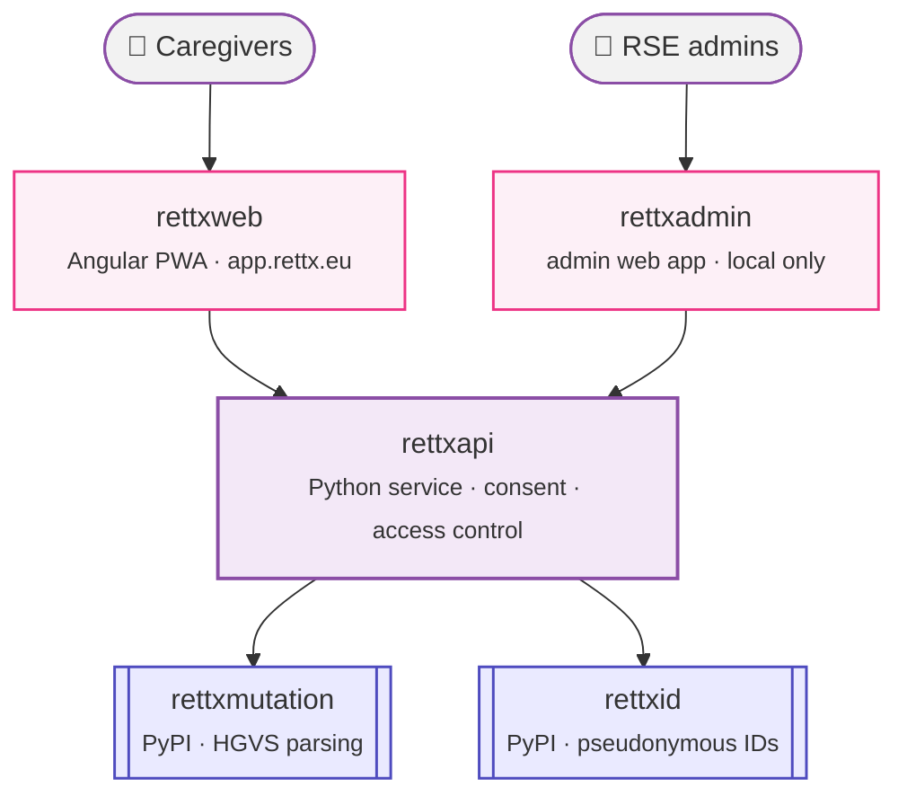

rettX has a caregiver app, a local tool for RSE administrators, and an API
that enforces access to registry data. This page explains how those
components fit together; the [security and privacy overview](/architecture/security/)
describes the controls in more detail.

## Layers

rettX is intentionally small for a healthcare system. There are three
runtime layers and two supporting libraries:

## Trust boundaries

- **Caregivers** can access only the patient records explicitly granted
  to them. **RSE administrators** have role-scoped permissions for registry
  operations. All authorisation is enforced server-side in `rettxapi`.
- The **admin app** runs locally and is not publicly deployed.
  It is available only to RSE administrators, not clinicians.
  Local operation does not replace authentication or API permission checks.
- `rettxapi` is the only component that touches identifiable data at
  rest. Pseudonymous identifiers come from `rettxid`; mutation strings
  are normalised through `rettxmutation`.
- The **docs site** (this site) and the **WordPress landing site** at
  `rettx.eu` are static and have no access to patient data.

## From caregiver to registry

Caregivers register a person, upload diagnosis documents, respond to
requests for more information, and receive messages from the registry.
RSE administrators review those submissions through their separate tool.
Both surfaces use the API; they do not communicate directly with each other.

The API checks the caller's identity and permissions before providing
access to records. Supporting libraries normalise genetic variant
descriptions and generate pseudonymous registry identifiers.

## What lives where

See the [ecosystem map](/welcome/ecosystem/) for which repository
holds what, and which are public versus private.
